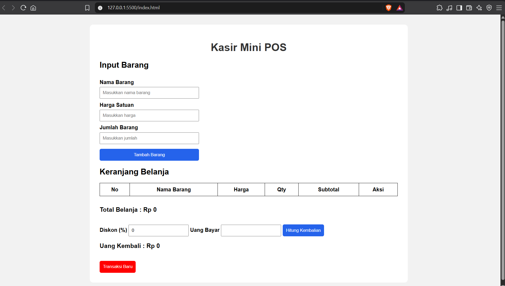
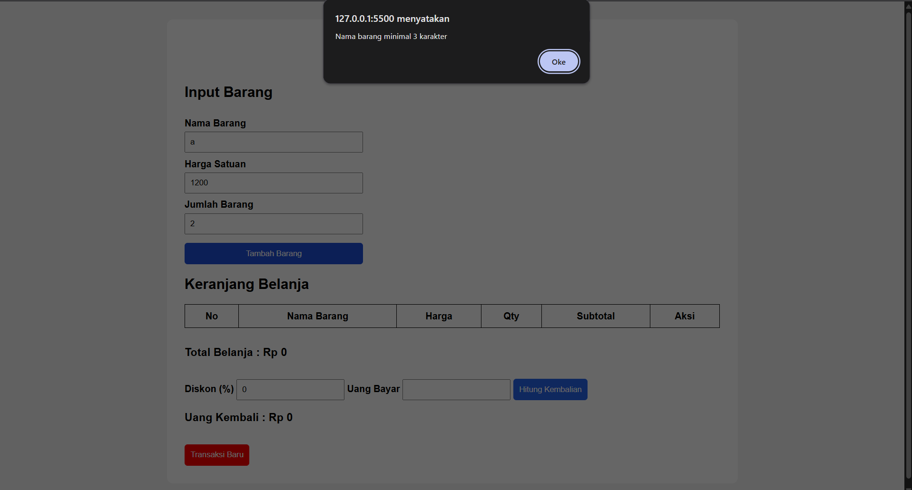
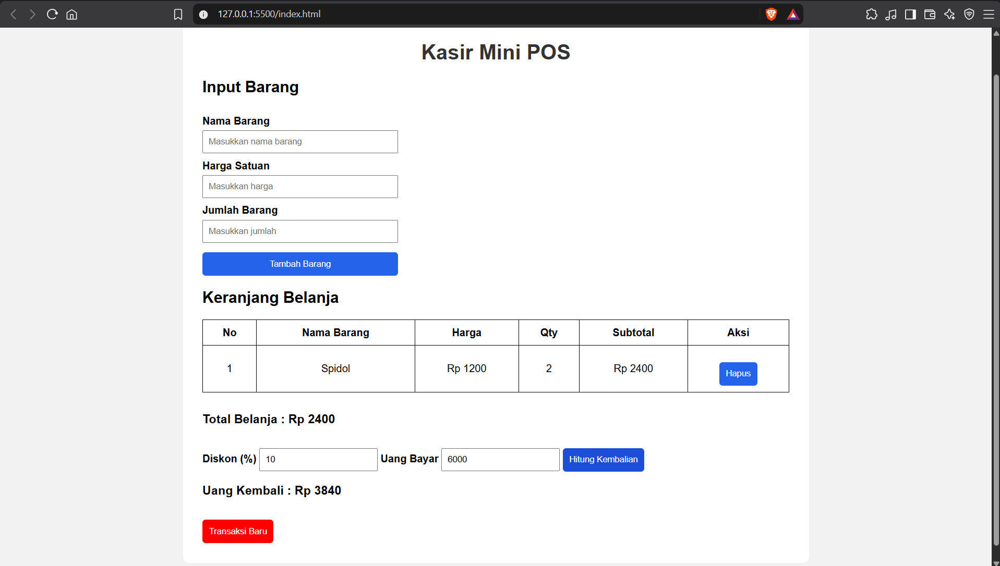

# Kasir Mini POS

## Identitas

Nama: Reza Lesmana Julgi
NIM: 124140115
Kelas: Praktikum PAW RA

## Deskripsi

Kasir Mini POS adalah aplikasi kasir sederhana berbasis HTML, CSS, dan JavaScript.

## Cara Menjalankan

1. Download repository
2. Buka folder menggunakan VS Code
3. Jalankan index.html dengan Live Server

## Fitur

- Tambah barang
- Hapus barang
- Validasi input
- Perhitungan subtotal
- Diskon
- Uang kembali
- Penyimpanan LocalStorage

## Teknologi

HTML

CSS

JavaScript

## Screenshot Aplikasi

### 1. Tampilan Awal Aplikasi

### 2. Validasi Error

### 3. Hasil Transaksi

