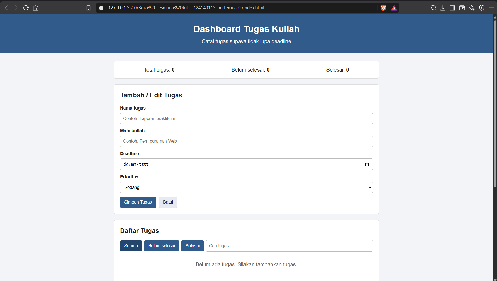
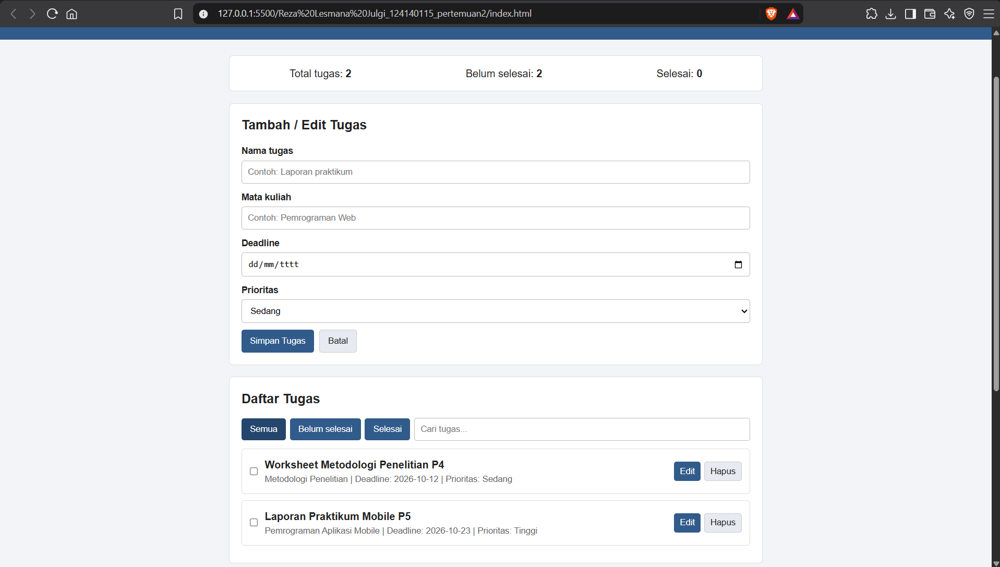
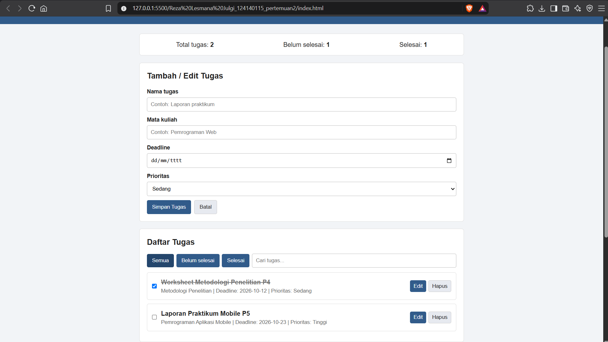

# Dashboard Tugas Kuliah

Aplikasi sederhana untuk mencatat tugas kuliah. Dibuat untuk tugas Praktikum Pengembangan Aplikasi Web, materi JavaScript ES6+.

## Identitas

- Nama: Reza Lesmana Julgi
- NIM: 124140115
- Kelas: Praktikum PAW RA

## Fitur
- Menambah tugas, mengedit, dan menghapus tugas.
- Menyimpan nama tugas, mata kuliah, deadline, dan prioritas.
- Menandai tugas sudah selesai.
- Filter tugas dan pencarian.
- Menampilkan jumlah total tugas, tugas selesai, dan tugas yang belum selesai.
- Menyimpan data menggunakan localStorage.
- Mengambil kutipan motivasi dan informasi cuaca menggunakan API publik

## Cara menjalankan
1. Buka folder ini menggunakan Visual Studio Code.
2. Buka `index.html` menggunakan Live Server.
3. Pastikan internet aktif untuk fitur kutipan dan cuaca.

## Fitur JavaScript ES6+
- `let` dan `const` untuk variabel.
- Arrow functions pada fungsi dan event listener.
- Template literals untuk menampilkan data tugas.
- Destructuring pada `button.dataset`.
- Spread operator untuk menambah data ke array.
- Array methods: `map`, `filter`, `find`, `forEach`, dan `sort`.
- Classes: `TaskItem` dan `DashboardApp`.
- `async/await` dan `fetch()` untuk mengambil data API.
- `localStorage` untuk menyimpan tugas.

## Struktur file
- `index.html`: struktur halaman.
- `style.css`: tampilan sederhana.
- `script.js`: fungsi aplikasi.
- `README.md`: dokumentasi.

## Pengujian
1. Tambah tugas baru.
2. Edit tugas.
3. Tandai tugas selesai.
4. Hapus tugas.
5. Refresh halaman untuk memastikan data tetap tersimpan.
6. Coba filter dan pencarian.
7. Periksa kutipan dan cuaca jika internet tersedia.

## Screenshot Sistem

Gambar 1. Tampilan utama aplikasi Dashboard Tugas Kuliah

Gambar 2. Tampilan utama sistem jika ada tugas yang ditambahkan

Gambar 3. Tampilan utama sistem jika ada tugas yang sudah dikerjakan