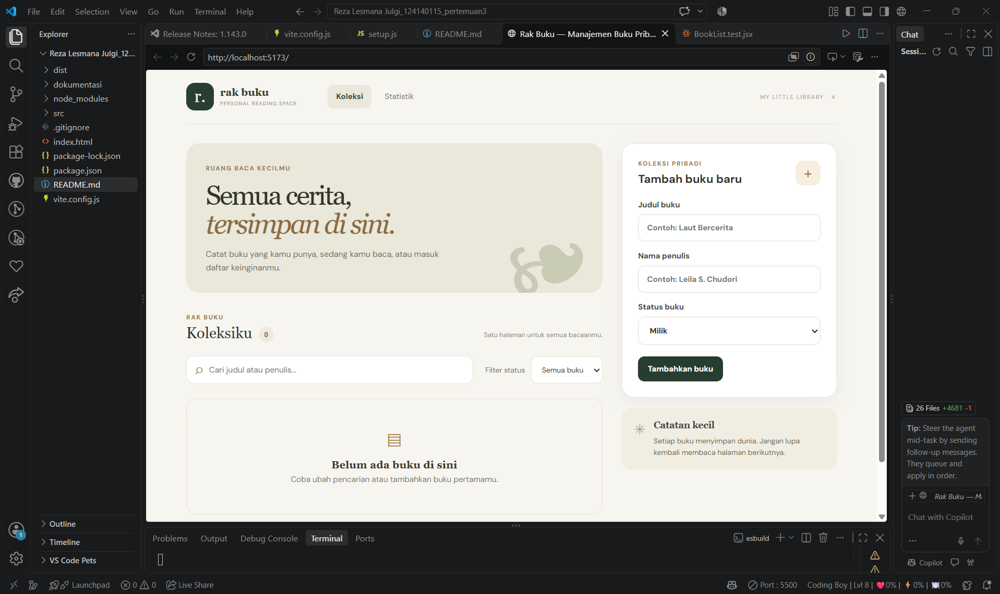
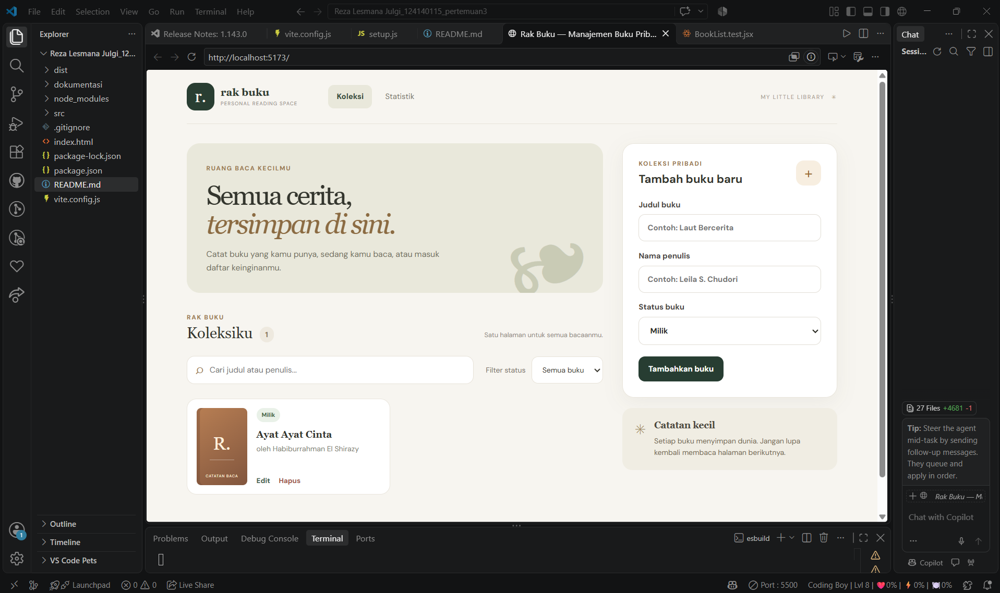
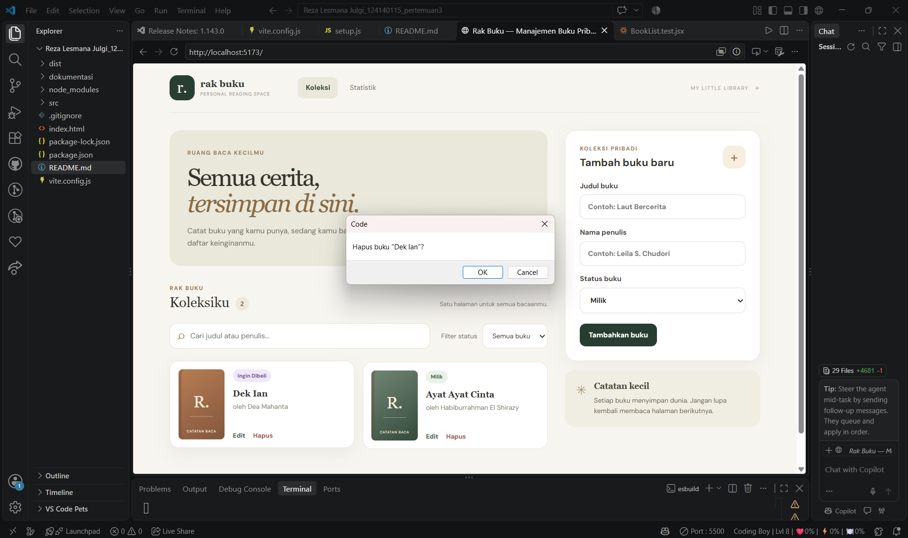
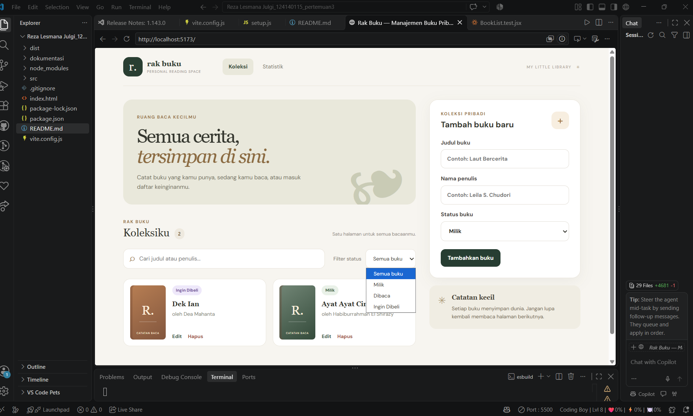
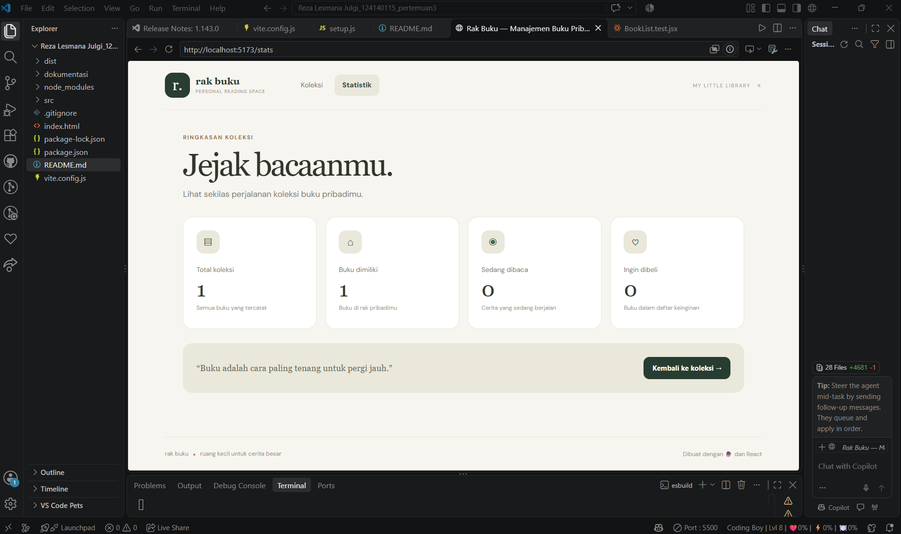

# Rak Buku — Manajemen Buku Pribadi

Aplikasi web untuk mengelola koleksi buku pribadi, mulai dari buku yang dimiliki, sedang dibaca, hingga buku yang ingin dibeli. Aplikasi dibuat menggunakan React sebagai tugas Praktikum Pengembangan Aplikasi Web Pertemuan 3: React Basics.

## Fitur Aplikasi

1. **Tambah Buku** — Menambahkan buku dengan judul, nama penulis, dan status buku.
2. **Edit Buku** — Mengubah informasi buku yang sudah tersimpan.
3. **Hapus Buku** — Menghapus buku dari koleksi.
4. **Pencarian Buku** — Mencari buku berdasarkan judul atau nama penulis.
5. **Filter Status** — Menampilkan buku berdasarkan status yang dipilih.
6. **Statistik Buku** — Melihat ringkasan jumlah buku berdasarkan status.
7. **Penyimpanan Data** — Menyimpan data buku menggunakan `localStorage`, sehingga data tetap tersedia setelah halaman dimuat ulang pada browser yang sama.

## Teknologi yang Digunakan

- React
- Vite
- JavaScript
- React Router DOM
- React Hooks (`useState` dan `useEffect`)
- Context API
- Custom Hooks
- PropTypes
- localStorage
- Vitest
- React Testing Library

## Struktur Folder

```text
Reza Lesmana Julgi_124140115_pertemuan3/
├── dokumentasi/
│   ├── tampilanawal.png
│   ├── bukuditambah.png
│   ├── menghapusbuku.png
│   ├── fiturfilter.png
│   └── statistik.png
├── src/
│   ├── components/
│   │   ├── BookForm/
│   │   ├── BookList/
│   │   └── BookFilter/
│   ├── context/
│   │   └── BookContext.jsx
│   ├── hooks/
│   │   ├── useLocalStorage.js
│   │   └── useBookStats.js
│   ├── pages/
│   │   ├── Home/
│   │   └── Stats/
│   ├── test/
│   │   ├── BookForm.test.jsx
│   │   ├── BookList.test.jsx
│   │   └── setup.js
│   ├── App.jsx
│   ├── main.jsx
│   └── styles.css
├── .gitignore
├── index.html
├── package.json
├── package-lock.json
├── README.md
└── vite.config.js
```

## Persyaratan

Pastikan perangkat sudah memiliki:

- Node.js versi LTS
- npm

## Cara Instalasi dan Menjalankan Aplikasi

1. Buka folder project di Visual Studio Code.
2. Buka terminal melalui menu **Terminal → New Terminal**.
3. Instal seluruh dependensi:

   ```bash
   npm install
   ```

4. Jalankan aplikasi dalam mode pengembangan:

   ```bash
   npm run dev
   ```

5. Buka alamat lokal yang muncul di terminal, biasanya `http://localhost:5173/`.

Jika menggunakan PowerShell Windows dan perintah `npm` mengalami kendala, gunakan `npm.cmd` sebagai penggantinya.

## Cara Menjalankan Unit Testing

Jalankan perintah berikut di terminal:

```bash
npm run test:run
```

Pengujian menggunakan Vitest dan React Testing Library.

Hasil pengujian saat dokumentasi ini dibuat:

- `BookForm.test.jsx`: 3 test berhasil.
- `BookList.test.jsx`: 3 test berhasil.
- Total: **6 test berhasil dari 6 test**.

## Build untuk Produksi

Untuk memeriksa apakah aplikasi dapat dikompilasi untuk produksi, jalankan:

```bash
npm run build
```

Hasil build akan disimpan di folder `dist/`.

Build berhasil dijalankan saat pengujian dengan Vite 6.4.5.

## Dokumentasi Aplikasi

Screenshot dokumentasi disimpan di folder `dokumentasi/`.

### 1. Tampilan Awal



Halaman utama aplikasi yang menampilkan koleksi buku, kolom pencarian, filter status, dan formulir penambahan buku.

### 2. Buku Ditambah



Contoh tampilan setelah buku berhasil ditambahkan ke dalam koleksi.

### 3. Menghapus Buku



Contoh proses penghapusan buku dari koleksi pribadi.

### 4. Fitur Filter



Tampilan fitur filter untuk menyaring buku berdasarkan statusnya.

### 5. Statistik



Halaman statistik yang menampilkan ringkasan jumlah buku berdasarkan status.

## Konsep React yang Diterapkan

- **Functional Components:** Membagi aplikasi menjadi komponen-komponen yang memiliki tanggung jawab masing-masing.
- **Props dan PropTypes:** Mengirim data antarkomponen dan memeriksa tipe props.
- **useState:** Mengelola state seperti data buku, pencarian, filter, dan input formulir.
- **useEffect:** Menangani efek samping, termasuk sinkronisasi data.
- **Context API:** Membagikan state dan fungsi pengelolaan buku ke beberapa komponen.
- **Custom Hooks:** Memisahkan logika penyimpanan dan perhitungan statistik agar dapat digunakan kembali.
- **React Router DOM:** Mendukung navigasi antara halaman Koleksi dan Statistik.
- **localStorage:** Menyimpan data buku di browser.

## Catatan

Data buku disimpan di `localStorage` browser. Data tidak otomatis tersinkronisasi antarperangkat atau antarbrowser.

Aplikasi ini dibuat untuk memenuhi tugas Praktikum Pengembangan Aplikasi Web Pertemuan 3: React Basics.
