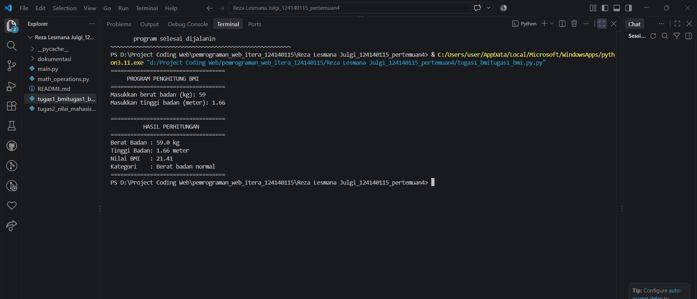
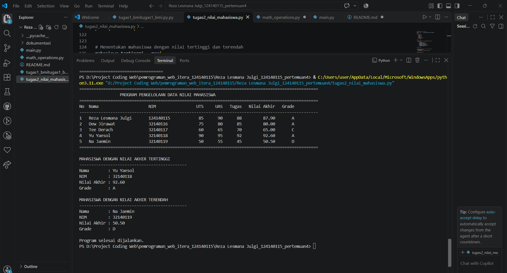
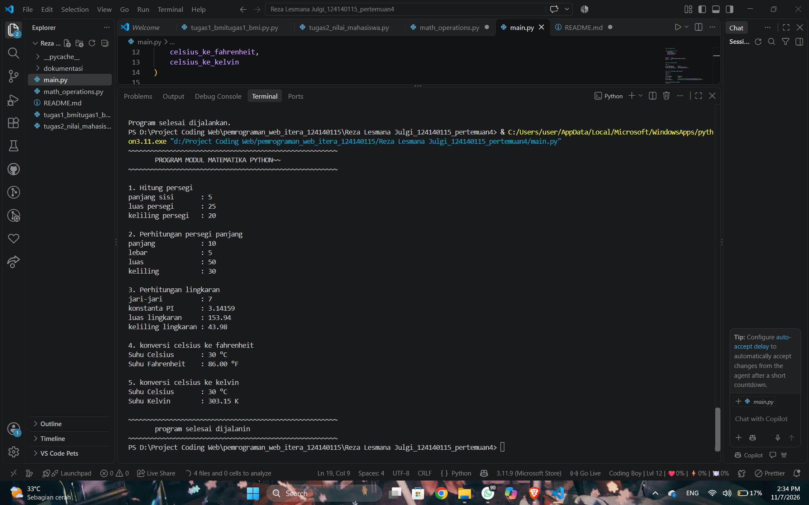

# PRAKTIKUM PEMROGRAMAN APLIKASI WEB
## Pertemuan 4 – Python Dasar

### Identitas Mahasiswa

- **Nama:** Reza Lesmana Julgi
- **NIM:** 124140115
- **Kelas:** Praktikum PAW RA

---

## Deskripsi Praktikum

Praktikum ini membahas dasar-dasar pemrograman Python, meliputi penggunaan variabel, tipe data, struktur kontrol, fungsi, struktur data, serta penggunaan modul dan package Python.

Pada praktikum ini terdapat tiga program yang dibuat sebagai penerapan materi Python Dasar.

## 1. Program Penghitung BMI

**Nama File:** `tugas1_bmi.py`

Program ini digunakan untuk menghitung Body Mass Index (BMI) berdasarkan berat dan tinggi badan pengguna.

**Fitur Program:**
- Menerima input berat badan dalam kilogram.
- Menerima input tinggi badan dalam meter.
- Menghitung nilai BMI.
- Menentukan kategori berat badan menggunakan percabangan `if-elif-else`.
- Menampilkan hasil perhitungan BMI.

**Rumus:**

BMI = Berat Badan / (Tinggi Badan × Tinggi Badan)

## 2. Program Pengelolaan Data Nilai Mahasiswa

**Nama File:** `tugas2_nilai_mahasiswa.py`

Program ini digunakan untuk mengelola dan menghitung nilai mahasiswa menggunakan struktur data list dan dictionary.

**Fitur Program:**
- Menyimpan data minimal lima mahasiswa.
- Menggunakan dictionary untuk menyimpan nama, NIM, nilai UTS, nilai UAS, dan nilai tugas.
- Menghitung nilai akhir dengan bobot UTS 30%, UAS 40%, dan tugas 30%.
- Menentukan grade berdasarkan nilai akhir.
- Menampilkan data mahasiswa dalam bentuk tabel.
- Menampilkan mahasiswa dengan nilai tertinggi dan terendah.

## 3. Modul Matematika Python

**Nama File:**
- `math_operations.py`
- `main.py`

Program ini menerapkan penggunaan modul dan fungsi dalam Python. File `math_operations.py` berisi kumpulan fungsi matematika, sedangkan `main.py` digunakan untuk memanggil dan menjalankan fungsi tersebut.

**Fitur Program:**
- Menghitung luas dan keliling persegi.
- Menghitung luas dan keliling persegi panjang.
- Menghitung luas dan keliling lingkaran.
- Menggunakan konstanta PI.
- Mengonversi suhu Celsius ke Fahrenheit.
- Mengonversi suhu Celsius ke Kelvin.
- Menggunakan dua metode import modul Python.

---

## Cara Menjalankan Program

Pastikan Python sudah terinstal pada komputer.

1. Buka folder praktikum melalui Visual Studio Code.
2. Buka file Python yang ingin dijalankan.
3. Buka terminal atau gunakan fitur Run Python File in Terminal.
4. Jalankan program sesuai nama file.

Contoh perintah melalui terminal:

```bash
python tugas1_bmi.py
```

```bash
python tugas2_nilai_mahasiswa.py
```

Untuk program modul matematika, jalankan:

```bash
python main.py
```

Pastikan file `math_operations.py` dan `main.py` berada dalam folder yang sama.

---

## Dokumentasi Hasil Program

### 1. Hasil Program Penghitung BMI



### 2. Hasil Program Pengelolaan Data Nilai Mahasiswa



### 3. Hasil Program Modul Matematika Python




---

## Kesimpulan

Berdasarkan praktikum Python Dasar yang telah dilakukan, dapat dipahami penggunaan variabel, tipe data, percabangan, perulangan, fungsi, list, dictionary, serta modul dalam pemrograman Python.

Melalui ketiga program tersebut, materi yang telah dipelajari dapat diterapkan untuk menyelesaikan permasalahan sederhana menggunakan bahasa pemrograman Python.