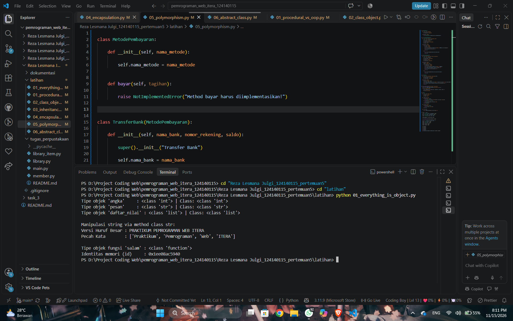
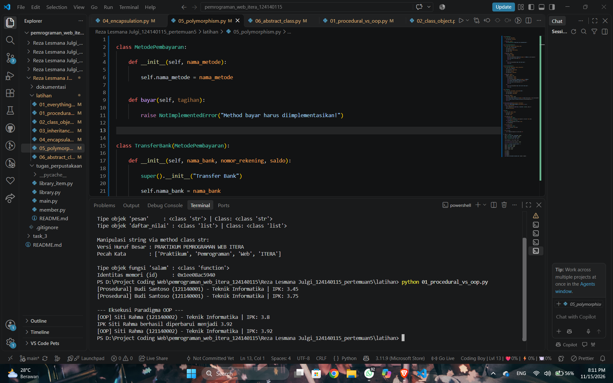
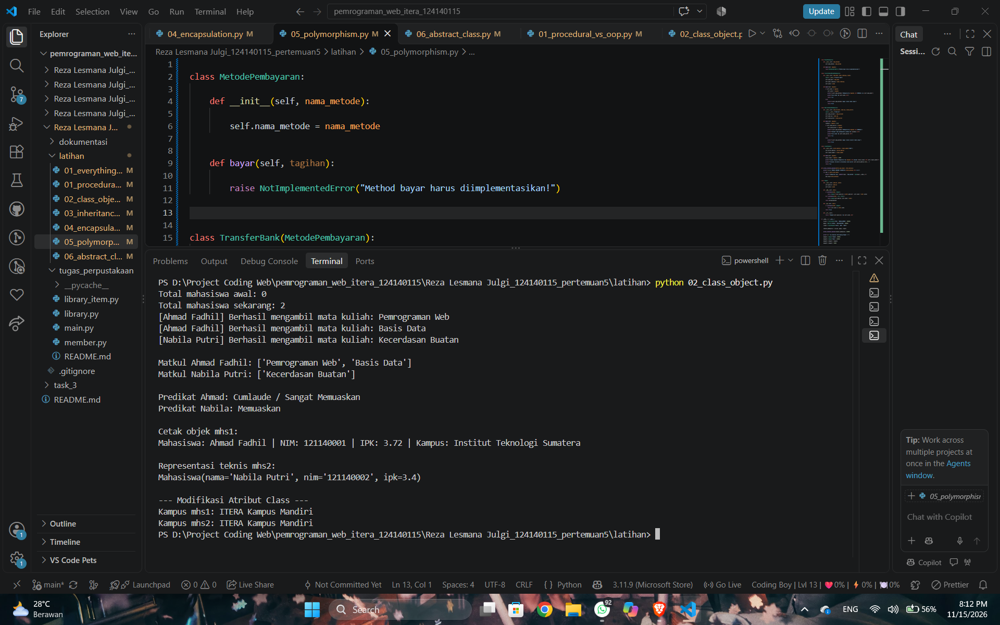
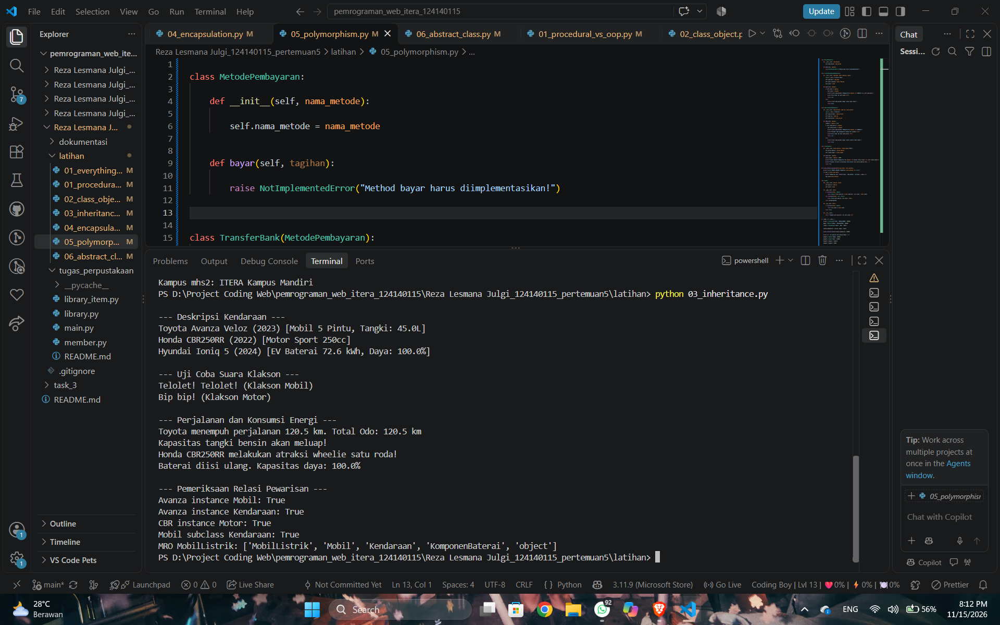
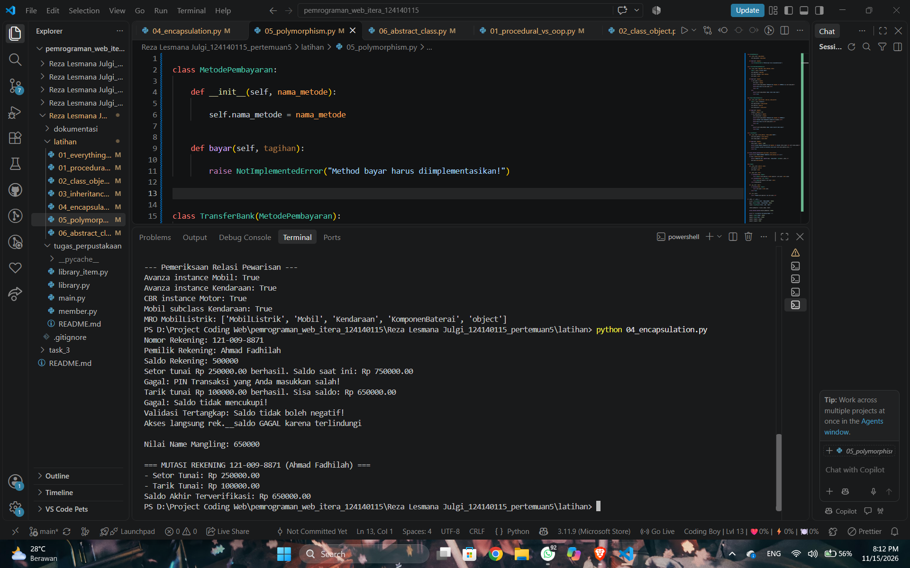
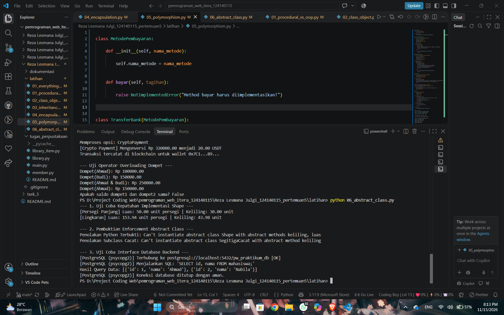

# Dokumentasi Latihan Praktikum OOP Python

## Identitas Mahasiswa

Nama: Reza Lesmana Julgi  
NIM: 124140115  
Mata Kuliah: Pemrograman Web

## Deskripsi

Latihan praktikum ini membahas penerapan konsep Object-Oriented Programming (OOP) menggunakan bahasa Python. Materi yang dipelajari meliputi Everything is Object, Procedural vs OOP, Class dan Object, Inheritance, Encapsulation, Polymorphism, serta Abstract Class.

## 1. Everything is Object

**File:** `01_everything_is_object.py`

Mempelajari bahwa setiap nilai dalam Python merupakan objek, serta penggunaan `type()`, `id()`, dan method bawaan objek.

**Dokumentasi:**

## 2. Procedural vs OOP

**File:** `01_procedural_vs_oop.py`

Membandingkan pendekatan pemrograman prosedural dengan Object-Oriented Programming melalui contoh pengelolaan data mahasiswa.

**Dokumentasi:**

## 3. Class dan Object

**File:** `02_class_object.py`

Mempelajari pembuatan class dan object, constructor, class attribute, instance attribute, method, serta dunder methods.

**Dokumentasi:**

## 4. Inheritance

**File:** `03_inheritance.py`

Menerapkan konsep pewarisan class menggunakan superclass dan subclass, method overriding, super(), serta multiple inheritance.

**Dokumentasi:**

## 5. Encapsulation dan Properties

**File:** `04_encapsulation.py`

Mempelajari cara melindungi atribut menggunakan private attribute, property decorator, getter, setter, dan validasi data.

**Dokumentasi:**

## 6. Polymorphism dan Operator Overloading

**File:** `05_polymorphism.py`

Menerapkan polymorphism melalui beberapa metode pembayaran serta operator overloading menggunakan method khusus Python.

**Dokumentasi:**

## 7. Abstract Class dan Interface

**File:** `06_abstract_class.py`

Mempelajari pembuatan abstract class, abstract method, dan interface menggunakan modul `abc` pada Python.

**Dokumentasi:**

## Kesimpulan

Melalui latihan praktikum ini, mahasiswa mempelajari dan menerapkan konsep dasar Object-Oriented Programming pada Python, mulai dari class dan object hingga inheritance, encapsulation, polymorphism, dan abstract class.