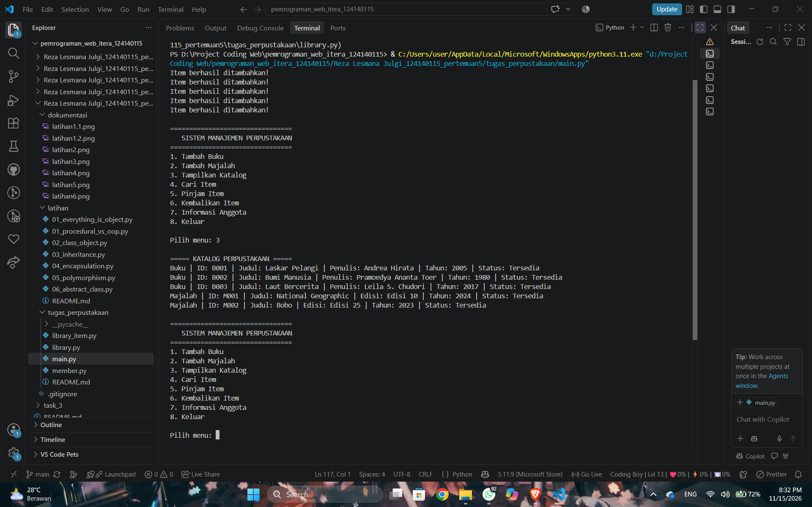
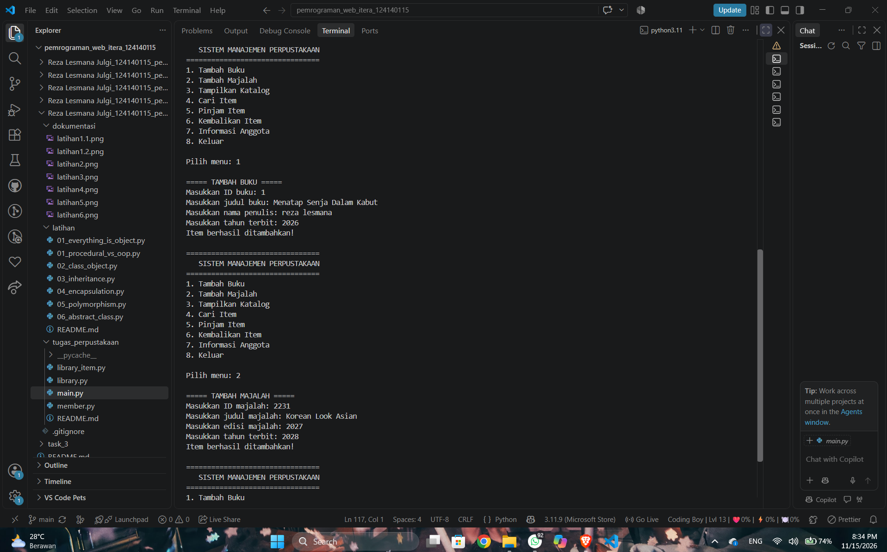
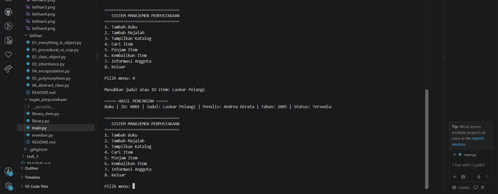
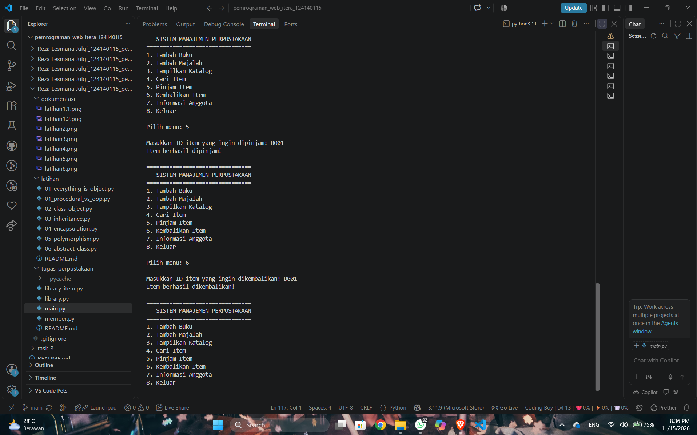
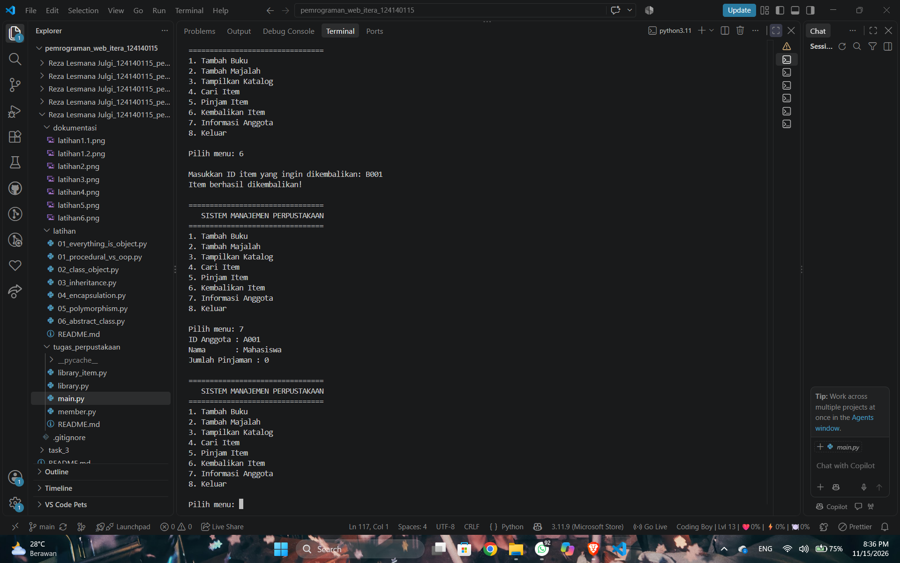

# Sistem Manajemen Perpustakaan Sederhana

## Identitas Mahasiswa

Nama: Reza Lesmana Julgi  
NIM: 124140115  
Mata Kuliah: Pemrograman Web

## Deskripsi

Sistem Manajemen Perpustakaan Sederhana merupakan program berbasis Python yang dibuat dengan menerapkan konsep Object-Oriented Programming (OOP).

Program ini digunakan untuk mengelola koleksi buku dan majalah, menampilkan katalog, melakukan pencarian item, serta mengelola proses peminjaman dan pengembalian.

## Konsep OOP yang Diterapkan

1. **Abstract Class**

   Menggunakan `LibraryItem` sebagai abstract class yang menjadi dasar untuk class lainnya.

2. **Inheritance**

   Class `Book` dan `Magazine` mewarisi atribut dan method dari `LibraryItem`.

3. **Encapsulation**

   Menggunakan atribut private untuk melindungi data dan mengatur akses melalui property decorator.

4. **Polymorphism**

   Menggunakan method `get_detail()` yang memiliki implementasi berbeda pada setiap subclass.

5. **Property Decorator**

   Menggunakan `@property` dan setter untuk mengakses serta mengubah atribut tertentu.

## Struktur File

- `library_item.py`: Berisi abstract class `LibraryItem` serta subclass `Book` dan `Magazine`.
- `member.py`: Mengelola informasi anggota perpustakaan.
- `library.py`: Mengelola koleksi dan fitur perpustakaan.
- `main.py`: Menjalankan program utama dan menampilkan menu interaktif.

## Fitur Program

1. Menambahkan buku.
2. Menambahkan majalah.
3. Menampilkan katalog perpustakaan.
4. Mencari item berdasarkan judul atau ID.
5. Meminjam item.
6. Mengembalikan item.
7. Menampilkan informasi anggota.

## Dokumentasi Program

### 1. Menampilkan Katalog Perpustakaan

Menampilkan daftar buku dan majalah yang tersimpan di dalam sistem beserta informasi dan status ketersediaannya.



### 2. Menambahkan Buku dan Majalah

Menampilkan proses penambahan data buku dan majalah ke dalam koleksi perpustakaan.



### 3. Pencarian Item

Menampilkan proses pencarian koleksi perpustakaan berdasarkan judul atau ID item.



### 4. Peminjaman dan Pengembalian Item

Menampilkan proses peminjaman dan pengembalian buku atau majalah serta perubahan status ketersediaannya.



### 5. Informasi Anggota

Menampilkan informasi anggota perpustakaan berupa ID anggota, nama, dan jumlah pinjaman.



## Cara Menjalankan Program

1. Buka folder `tugas_perpustakaan` melalui Visual Studio Code.
2. Buka terminal.
3. Jalankan perintah berikut:

```bash
python main.py
```

4. Pilih menu sesuai fitur yang ingin digunakan.
5. Masukkan data sesuai instruksi yang ditampilkan pada terminal.

## Kesimpulan

Melalui pembuatan program ini, konsep Object-Oriented Programming pada Python dapat diterapkan dalam sistem pengelolaan perpustakaan sederhana. Program ini menggabungkan abstract class, inheritance, encapsulation, dan polymorphism untuk mengelola data buku, majalah, serta aktivitas perpustakaan.